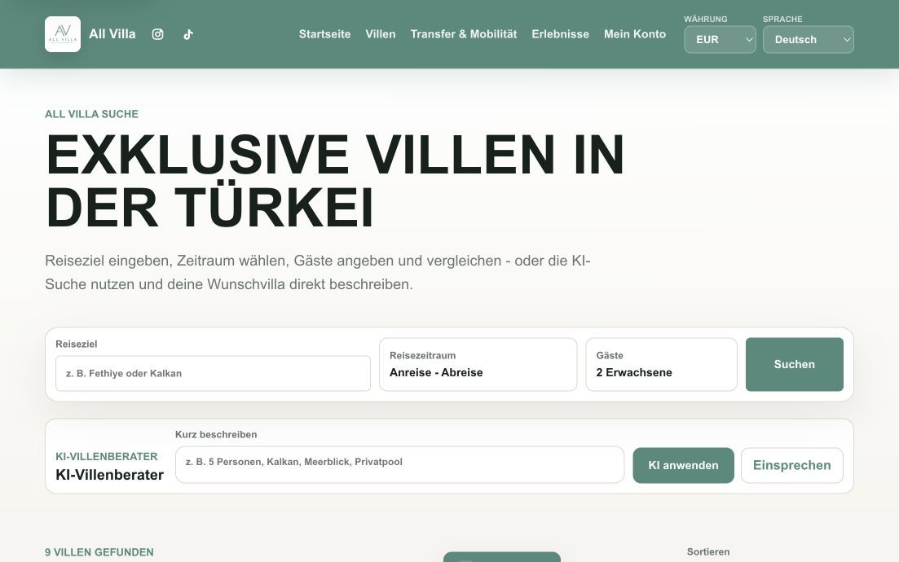

# All Villa

### Ferienvillen finden – eine deutschsprachige Nutzererfahrung gestalten

Eine Fallstudie von **Cem Bagana** zu Produktkonzeption, Lokalisierung und technischer Umsetzung im Reisebereich.

[Portfolio](https://www.cembagana.de/) · [LinkedIn](https://www.linkedin.com/in/cem-bagana/) · [GitHub-Profil](https://github.com/cembagana62-jpg)

## Die Aufgabe

Eine Ferienvilla auszuwählen verlangt mehr als schöne Bilder: Reisende brauchen einen passenden Zeitraum, verständliche Ausstattung, nachvollziehbare Preise und einen klaren nächsten Schritt. All Villa ist ein Entwicklungsprojekt für eine deutschsprachige Plattform zur Vermittlung von Ferienvillen in der Türkei.

Ziel ist es, Inspiration, Suche, Vergleich und Buchungsvorbereitung in einer zusammenhängenden Nutzerführung zu verbinden.

## Mein Beitrag

Meine bestehende Portfolio-Fallstudie beschreibt meine Rolle im IT-Produktmanagement und in der technischen Umsetzung:

- Anforderungen von Reisenden, Villenpartnern und Administration strukturieren.
- Produktkonzept und deutschsprachige Informationsarchitektur entwickeln.
- Such-, Detail- und Buchungsoberflächen gestalten und technisch umsetzen.
- Daten für Unterkünfte, Nutzer und Buchungen strukturieren.
- Externe Integrationen und mehrsprachige Nutzung in der Produktplanung berücksichtigen.

## Einstieg über die Suche

*Vorhandene Portfolio-Aufnahme eines Entwicklungsstands; das genaue Aufnahmedatum ist nicht dokumentiert. Sichtbare Trefferzahlen sind kein Nachweis eines aktuell buchbaren Bestands. Das gezeigte KI-Bedienelement belegt die Oberfläche, nicht die Qualität oder den Livebetrieb eines Beratungsdienstes.*

Die klassische Suche fragt Reiseziel, Zeitraum und Gäste ab. Ergänzend sieht das Konzept eine Beschreibung der Wunschunterkunft in eigenen Worten vor. Für die Produktgestaltung ist dabei entscheidend, dass der direkte Suchweg leicht erreichbar bleibt.

## Von der Auswahl zur Buchungsvorbereitung

**Reiseziel und Zeitraum → Suchergebnisse → Unterkunft vergleichen → Details prüfen → Buchung vorbereiten**

| Schritt | Produktfrage |
| --- | --- |
| Suche | Welche Angaben sind für passende Ergebnisse nötig? |
| Vergleich | Welche Unterschiede bei Lage, Ausstattung und Preis helfen bei der Auswahl? |
| Details | Welche Informationen fehlen noch für eine Entscheidung? |
| Buchungsvorbereitung | Sind Reisedaten, Gesamtpreis und Verfügbarkeit nachvollziehbar? |
| Bearbeitung | Wie greifen Reisende, Partner und Administration ineinander? |

## Entwicklungsstand

**Lokal dokumentiert:** Startseite, Villensuche, Detailansicht und Buchungseinstieg ließen sich in der Browserprüfung vom **23.09.2026** öffnen. Desktop- und mobile Ansichten wurden stichprobenartig geprüft.

**Vor einem produktiven Einsatz zu klären:** einheitliche Preis- und Angebotsdaten, belastbare Verfügbarkeit, die Trennung von Beispielinhalten und freigegebenem Bestand sowie der vollständige Buchungsablauf. Der damalige Prüfstand enthielt unter anderem widersprüchliche Preise und Bewertungen sowie einen Platzhalterkalender. Ob diese Punkte inzwischen behoben sind, wurde für diese Veröffentlichung nicht erneut technisch geprüft.

**Nicht durchgängig getestet:** Anmeldung, Zahlungen, E-Mail-Versand sowie Partner- und Administrationsprozesse. Die Projektdokumentation beschreibt externe Integrationen als vorbereitet; daraus wird hier kein aktueller Livebetrieb abgeleitet.

## Produktentscheidungen und nächste Schritte

1. **Verlässliche Informationen zuerst:** gemeinsame Datenquellen für Preise, Ausstattung und Verfügbarkeit nutzen.
2. **Reisedaten vor Gesamtpreis:** konkrete Summen erst für einen gewählten Zeitraum darstellen.
3. **Mobile Suche vereinfachen:** Ziel, Datum, Gäste und Suchaktion klar priorisieren.
4. **Buchungsweg vollständig prüfen:** anschließend Bestätigung, Fehlerfälle und Stornierung mit geeigneten Testdaten erproben.

Diese Punkte beschreiben die aus dem dokumentierten Prüfstand abgeleitete Priorisierung, keine bereits abgeschlossenen Maßnahmen.

## Was diese Arbeitsprobe zeigt

All Villa veranschaulicht, wie ich eine komplexe Plattform aus Nutzersicht strukturiere. Lokalisierung bedeutet dabei, Sprache, Informationsbedarf, Daten und Abläufe zusammenzudenken. Der Schwerpunkt dieser Arbeitsprobe liegt auf Produktlogik und Nutzerführung.

## Quellen und Stand

Zusammengestellt am **20.10.2026** anhand meiner bestehenden Portfolio-Fallstudie, der Projektübersicht und der lokalen Websiteprüfung vom 23.09.2026. Diese Veröffentlichung enthält die Projektvorstellung und eine ausgewählte Portfolio-Aufnahme. Sie ist kein aktuelles Reiseangebot und bestätigt keine geschäftliche Partnerschaft oder produktive Buchungsabwicklung.

Weitere Arbeitsproben: [FA Finance](https://github.com/cembagana62-jpg/fa-finance-case-study) · [Kamm In](https://github.com/cembagana62-jpg/kamm-in-case-study)
